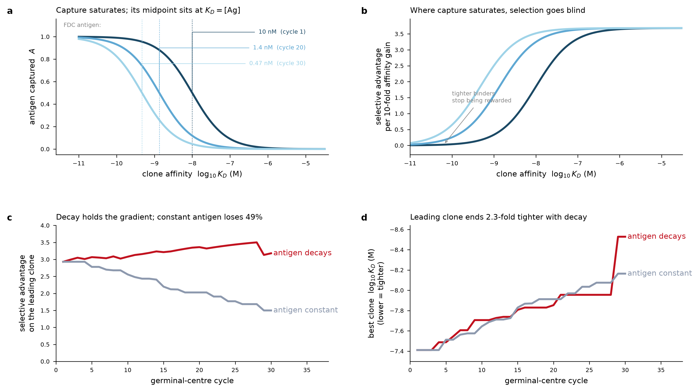

# spleen-twin

A digital-twin spleen that generates antibodies the way a spleen does — and
then keeps improving them in a wet-dry closed loop.

The package models the humoral response end to end as separable modules:
antigen presentation, CD4⁺ T-cell help, V(D)J recombination, tolerance,
B-cell activation, germinal-centre affinity maturation, class switching,
antibody output, and developability gating. Each module is driven by real
germline sequence, published mutation models and published parameters
rather than by invented constants.

```
antigen ─▶ APC / MHC-II ─▶ Tfh help ─┐
                                     ▼
V(D)J ─▶ tolerance ─▶ activation ─▶ germinal centre ─▶ plasma / memory
                                   (dark zone: SHM)        │
                                   (light zone: select)    ▼
                                              class switch ─▶ antibody
                                                              │
                                              reformatting ◀──┘
                                                      │
                                              developability gates
                                                      │
                                                   A / B / C
```

## What is real in here

| component | source |
|---|---|
| IGHV/IGHD/IGHJ, IGKV/IGKJ, IGLV/IGLJ germline segments | OLGA default models (Sethna et al., *Bioinformatics* 2019) |
| Segment usage, trimming, N-insertion length and dinucleotide models | same |
| P (palindromic) nucleotides | derived from the germline, not parameterised |
| SHM targeting and substitution | HH_S5F 5-mer model (Yaari et al., *Front Immunol* 2013), 1024 5-mers inferred from 806,860 silent mutations |
| IMGT FR/CDR boundaries | IMGT unique numbering (Lefranc et al. 2003) via `shazam`; 344 IMGT-gapped IGHV alleles via `tigger` |
| Model antigen | hen egg lysozyme, UniProt P00698 |
| Self panel for tolerance | eight abundant human proteins from UniProt |
| Amino-acid property scales | Janin transfer free energy, Kyte-Doolittle, residue volumes (Biopython) |
| Spleen cell composition reference | CELLxGENE Census 2025-11-08, `tissue_general == spleen` |

## What is a surrogate

**Affinity is a fitness function, not a prediction.** No available method
predicts antibody–antigen KD from sequence accurately enough to drive a
maturation simulation. `SurrogateAffinityOracle` produces a smooth,
epistatic, saturating landscape with the right dynamic range, calibrated so
the naive repertoire sits where real naive repertoires sit. Every number it
returns is a *simulated* KD. `AffinityOracle` is the interface for swapping
in a structural predictor.

The developability panel is likewise a set of **heuristic gates**, not
property predictors. It exists so the output funnel has the shape of a real
campaign, with attrition where real attrition happens.

## Emergent behaviour (not hard-coded)

Running the twin reproduces, without being told to:

- **~1/3 of rearrangements in frame** — junctional diversity is frame-agnostic.
- **CDR-H3 length ≈ 15–16 aa** (excluding IMGT anchors).
- **AID hotspots**: WRCY/RGYW positions come out ~3× more mutable than the rest of the sequence, purely from the S5F 5-mer table.
- **Replacement mutations accumulate in CDRs and are purged from frameworks** — the classic selection signature, produced by selection, not by biased targeting.
- **Clonal collapse**: a polyclonal germinal centre becomes oligoclonal.
- **Serum affinity rises while titre rises** — the defining feature of affinity maturation.

Tolerance is calibrated to the measured human outcome (~55% deleted, ~20%
anergic; Wardemann et al., *Science* 2003) rather than to an arbitrary
threshold, because self-reactivity scored against whole self proteins is an
extreme-value statistic with no transferable absolute scale.

## The closed loop

```
generate ─▶ curate ─▶ train ─▶ design ─▶ test ─▶ evaluate ─┐
    ▲                                                      │
    └──────────────────── feedback ────────────────────────┘
```

The loop is built around the two steps where real loops break:

**`curate` rejects unlearnable records.** A measurement without complete
provenance — animal, immunisation schedule, antigen lot and conformation,
assay, assay conditions, fitting model, pointer to the raw record — is
rejected rather than imputed. Assay families are tracked so kinetic and
equilibrium numbers are never silently pooled. Output follows AIRR
Rearrangement conventions.

**Negatives are retained by default.** Non-binders, poor expressers and
developability failures are the labels that teach a model where the cliff
is. Dropping them is the most common way a loop stops compounding; doing so
here requires explicitly passing `keep_negatives=False`.

**Every round runs a non-AI baseline.** `design` always proposes a
model-guided arm *and* a random arm on the same parents, and `evaluate`
reports which won. This is not decoration: in the AIntibody blind benchmark
(29 organisations, 511 AI-designed antibodies) a non-AI consensus baseline
outperformed all but two entries, and on the ranking task most models did
worse than random selection. A loop that never runs the baseline cannot
know whether its model contributes.

**Train/test splits are by lineage, not by sequence.** Germinal-centre
siblings differ by a handful of mutations; a random split puts
near-duplicates on both sides and inflates every metric.

**Failures are logged, not discarded.** Every proposal that regressed,
failed a gate, or was confidently mispredicted is written to a failure log
with the reason.

## Install

```bash
git clone https://github.com/<user>/spleen-twin
cd spleen-twin
pip install -e .
```

## Use

```bash
python examples/run_campaign.py --rounds 30 --seed 20261030
python examples/run_closed_loop.py --loops 5
```

```python
from spleen_twin.organ import Spleen
from spleen_twin.modules import antigen

ag = antigen.hen_egg_lysozyme()
spleen = Spleen(seed=20261030)
spleen.generate_naive_repertoire(n_cells=2500)
result = spleen.immunise(ag, n_rounds=30)

best = min(result.plasma_cells, key=lambda c: c.log10_kd)
print(best.rearrangement.v_gene, best.rearrangement.cdr3_aa, 10 ** best.log10_kd)
```

Swapping in your own antigen, affinity oracle or platform:

```python
from spleen_twin.modules.affinity import AffinityOracle
from spleen_twin.modules.reformatting import ReformattingModule

class MyStructuralOracle(AffinityOracle):
    def score(self, paratope, epitope_seq, framework_replacements=0):
        ...   # call a structure predictor, return an AffinityResult

spleen = Spleen(oracle=MyStructuralOracle())

# Platforms differ: VelocImmune/Kymouse/RenMab/OmniRat keep a murine
# constant region and need an in-vitro swap; XenoMouse humanises the
# constant region in the locus; CAMouse switches to human IgG in vivo.
reformatter = ReformattingModule(platform="XenoMouse")
```

## The affinity maturation model

Written out as equations in [`docs/affinity-maturation-model.md`](docs/affinity-maturation-model.md),
with the selection term derived and its ablation measured.



## Atlas grounding

Organ composition is measured, not assumed. `spleen_twin.organ.load_reference()`
returns the human spleen slice of CELLxGENE Census 2025-11-08
(`tissue_general == 'spleen' and is_primary_data == True`): **577,677 cells,
58 donors, 7 datasets, 110 annotated cell types, all from tissue annotated
`normal`**.

| measured quantity | value | used for |
|---|---|---|
| B lineage, all states | 32.8% of spleen | scale of the follicular compartment |
| naive-like B | 11.14% | founder pool size |
| memory B | 8.99% | exit split sanity check |
| plasma cells | 5.48% | antibody output compartment |
| Tfh | 1.23% | **Tfh per naive B = 0.110**, which sets light-zone help competition |
| germinal-centre B | 0.06% | negative control — GCs are induced, not resting |

`AtlasReference.gc_parameters(n_founders)` turns those into germinal-centre
settings, so the single most consequential parameter — how many centrocytes
can be rescued per cycle — comes from data rather than from tuning.

**What was not extracted:** the per-cell-type expression matrix. The 77-gene
panel in `scripts/fetch_spleen_census.py` resolves cleanly, but reading
expression for scattered cell coordinates out of a 159-million-cell SOMA array
did not finish in the session that built this package. No module depends on it;
running the script end to end regenerates it.

## Limitations

- Heavy chain only by default. Light chains rearrange (`ChainRecombinator("IGK")`) but are not paired into the affinity model; receptor editing is therefore disabled by default.
- Affinity and developability are surrogates, as described above.
- MHC-II presentation is a groove-fit heuristic that ranks peptides of one antigen against each other; it is not an epitope predictor.
- A single germinal centre is drift-dominated for neutral markers such as isotype; use `n_germinal_centers > 1` for population-level isotype distributions.
- Two rare IGHV alleles have no IMGT-gapped donor and are reported unannotated rather than guessed.

## Licence

MIT. See `LICENSE`.
